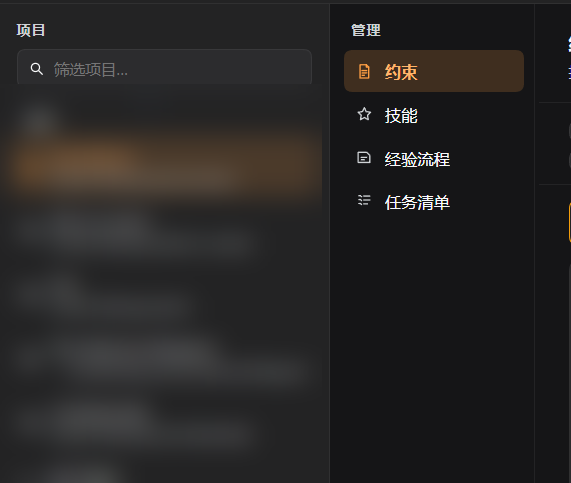
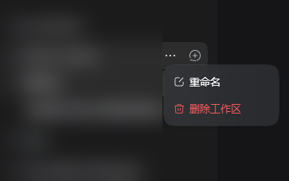

<p align="center">
  
</p>

<h1 align="center">dsh-heipm</h1>

<p align="center">A DSH project manager: constraints, skills, procedures and quest lists in one panel.</p>

[Features](#features) · [Screenshots](#screenshots) · [Install](#install) · [Configuration](#configuration) · [Security](#security) · [Development](#development) · [License](#license)

> [中文](README.md) | English

## Features

- **Projects**: reads the DSH workspace registry and supports subsequence fuzzy search (`/` focuses, `Esc` clears).
- **Constraints**: read and edit project/global `AGENTS.md` and `AGENTS.local.md` with version checks (409 on conflict) and a path whitelist.
- **Skills**: lists `.dsh/skills`, `skills/` and `.agents/skills` entries with names and descriptions.
- **Procedures**: shows knowledge cards under `.dsh/dsh-heipm/procedures/`, with built-in index/template/tools scaffolds.
- **Quest list**: parses `.dsh/dsh-heipm/任务清单.md` and cycles subtask states when ticked.
- **Workspace context menu**: right-click a workspace row in the built-in DSH sidebar to rename it or remove its registration, using the plugin theme.
- **Markdown table styling** (optional sub-plugin): rounded, outlined wide tables with an expand/collapse toggle.

## Screenshots





> Project and session names in the screenshots are blurred.

## Install

Requires DSH `0.2.1-rc.3` (see `engines.dsh` in `package.json`) and Node `>=22.19`.
This project is distributed **from GitHub only; it is not published to npm**.

1. Clone it anywhere:

   ```bash
   git clone https://github.com/heiqisangx-crypto/dsh-heipm.git D:/dsh-Workspace/dsh-heipm
   ```

2. In your target profile (for example `~/.dsh/profiles/desktop`), edit `package.json`:

   - add `"dsh-heipm": "link:D:/dsh-Workspace/dsh-heipm"` to `dependencies`
   - add `"dsh-heipm"` to `dsh.profile.bundles`

3. Install the link and restart DSH:

   ```bash
   cd ~/.dsh/profiles/desktop
   pnpm install
   ```

   Alternatively restart DSH and let it install profile dependencies.

> The package keeps `"private": true` because it is not published to npm.

## Configuration

Sub-plugin defaults live in `cordis.patch.yml`:

| id | Default | Purpose |
| --- | --- | --- |
| `dsh-heipm` | on | Project manager panel (constraints / skills / quest list / context menu) |
| `dsh-heipm-procedures` | off | Procedures section, prompt and tools |
| `dsh-heipm-quest-list` | on | Quest-list prompt and skill |
| `dsh-heipm-markdown` | off | Session Markdown table styling |

Override by id in the profile `cordis.patch.yml`, for example:

```yaml
- id: dsh-heipm-procedures
  disabled: false
```

## Security

- The local `/dsh-heipm/api` route accepts same-origin hosts only.
- File access is limited to whitelisted candidates (`AGENTS.md`, etc.) and registered project paths.
- Edits are capped at 512 KB; saves carry a version and return 409 on conflict.
- "Delete workspace" removes only the DSH registration; folders, files and session logs are kept.

## Development

No runtime dependencies; tests use Node built-ins only:

```bash
npm test
```

## Compatibility

- Developed and verified on DSH `0.2.1-rc.3`.
- The client plugin depends on the `slots`, `locale` and `workspaces` services; the context menu relies on the sidebar's `data-row-key` attribute.

## License

MIT © 2026 heiqisang and the dsh-heipm contributors. See [LICENSE](LICENSE).
