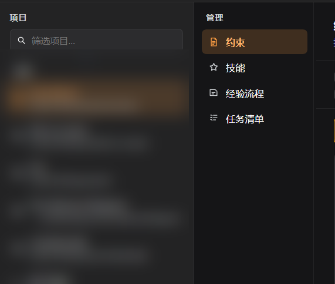
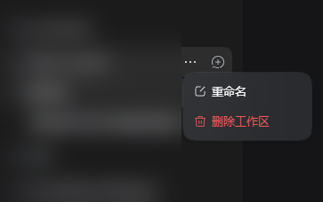

<p align="center">
  
</p>

<h1 align="center">dsh-heipm</h1>

<p align="center">DSH 项目管理面板：把每个项目的约束、技能、经验流程与任务清单收在一处。</p>

[关于](#关于这个项目) · [功能](#功能) · [来源与参考](#经验流程的来源与参考) · [目录结构](#目录结构) · [截图](#截图) · [安装](#安装) · [配置](#配置) · [样式设置](#样式设置) · [安全边界](#安全边界) · [开发](#开发) · [兼容性](#兼容性) · [License](#license)

> 中文 | [English](README.en.md)

## 关于这个项目

dsh-heipm 想做的是一套**程序员自己愿意天天用的编程项目管理工具**。作者本身是程序员，写这个插件的过程，也是在研究 DeepSeek Harness 怎样才能更好地融入每一个项目的日常：约束写在哪、技能放哪、踩过的坑怎么留、任务清单谁来维护。

DSH 的能力大多活在会话里，会话一关就散了。这个插件把它们落成项目里的文件：`AGENTS.md` 是约束，`.dsh/skills` 是技能，`.dsh/dsh-heipm/procedures` 是经验，`.dsh/dsh-heipm/quest.db` 是进度。面板只做三件事——看见它们、改它们、在它们变化时跟上。

会话本身也归它管一点：过程收纳把思考与工具调用收成图标条，样式设置让整套配色跟着使用者的眼睛走。

所以设计上一直偏向：文件优先、零运行时依赖（任务清单用 Node 内置的 `node:sqlite` 存成 `quest.db`，不引第三方库）、宿主契约缺失时失败关闭、每个 UI 特性都能一键关掉。

## 功能

| 功能 | 说明 | 可选 |
| --- | --- | --- |
| **项目列表** | 从 DSH workspace registry 读取项目，支持子序列模糊搜索（`/` 聚焦，`Esc` 清除）。 | 否 |
| **约束** | 读取/编辑项目与全局的 `AGENTS.md` / `AGENTS.local.md`，保存带版本校验，冲突返回 409，路径走白名单。 | 否 |
| **技能** | 扫描 `.dsh/skills`、`skills/`、`.agents/skills`，展示名称与描述。 | 否 |
| **经验流程** | 读取 `.dsh/dsh-heipm/procedures/` 下的知识卡，内置索引/模板/工具，可一键创建缺失文件；项目内的模板与插件内置版本不一致时标出「有更新」，支持逐个或一键更新（覆盖前二次确认）。 | 是（默认关） |
| **任务清单** | 存在 `.dsh/dsh-heipm/quest.db`（SQLite，状态是字段、写入走事务），子任务按「未完成 → 执行中 → 待验收 → 已完成」切换；`执行中` 的条目在面板里显示一个不断旋转的圆环，顶部汇总多出「执行中 N」；子任务全部完成时大块需求按叶子派生为已完成（重新打开子任务时撤销）。 | 是（默认开） |
| **任务跟踪** | 任务清单顶部两个视图：左「全部任务」看全集，右「任务跟踪」只放你盯上的大块需求；点「跟踪需求」展开可搜索的列表，被跟踪的需求强制保持展开，状态存在浏览器本地，刷新后还在。 | 是（默认开） |
| **按模块刷新** | 点项目或分区时只重读对应模块；面板在前台时每 3 秒比对一次指纹（任务清单比对数据库修订号），约束 / 技能 / 经验流程 / 任务清单有外部改动就自动更新（正在编辑的文件只提示重载，不覆盖）。 | 否 |
| **工作区右键菜单** | 在 DSH 自带侧边栏的工作区行上右键，弹出「重命名 / 删除工作区 / 打开项目根目录」，样式跟随[样式设置](#样式设置)。 | 否 |
| **样式设置** | 设置弹窗左侧新增 **heipm 样式**：强调色 / 面板底 / 卡片底 / 正文 / 次要文字 / 边框 / 圆角，改完即时生效，作用于主面板与全部子插件。 | 是（主插件常驻） |
| **Markdown 表格样式** | 给会话里的宽表加圆角、描边、斑马纹与「展开/收起」，配色跟随样式设置。 | 是（默认关） |
| **过程收纳** | 把两段正文之间的思考 / 工具调用行收进一条只有图标的框；点图标从右侧滑出抽屉看那一步的详情（思考正文 / 命令与结果），标题旁显示该步耗时。**纯视觉整理，实测不省性能**。 | 是（跟 Markdown 子插件） |

> 标「是」的是三个独立子插件（经验流程、任务清单、Markdown；过程收纳随 Markdown 子插件走）与主插件常驻的样式设置页。子插件可在 profile 里单独关闭；它们注入提示词/样式的生效时机见[配置](#配置)。

## 经验流程的来源与参考

**经验流程并非本插件原创**：提示词、知识卡格式（`INDEX.template.md` / `card-template.md` / `CLASSIFY.md`）以及「开工前按任务词定向查卡」这条约定，来自 [DSH-agent-procedures](https://github.com/MiHjy12138/DSH-agent-procedures)。本仓库做的是把它搬进面板、收编到 `.dsh/dsh-heipm/procedures/`，再按本插件的数据契约重新接线。

工程纪律与判断标准参考了：

- [UB mode](https://github.com/unclebob/ub-mode)（Uncle Bob）：先让它跑通，再从第一性重设计；测试行为而不是实现；失败两次先攻前提；先减后加。
- [AI Coding 的第一性](https://www.bilibili.com/opus/1261918888325545988)：关于 AI 参与编程时，人的精力应该放在哪里的讨论。

感谢上游作者和这些公开材料。

## 目录结构

```text
index.js                 Host 包入口：面板 API、主题文件、子插件开关查询
client.js                浏览器主入口：UI 特性、过程收纳、样式设置页
client.procedures.js     经验流程客户端分块（必须留在包根）
client.quest.js          任务清单客户端分块（必须留在包根）
procedures/              经验流程 Host 子插件：index.js / prompt.md / tools.js
quest-list/              任务清单 Host 子插件：index.js / prompt.md / SKILL.md
markdown/                Markdown 子插件：index.js / styles.js / icon.png
templates/               内置知识卡模板与工具
docs/HOST_CONTRACT.md    DSH 依赖契约、降级开关与升级 checklist
test/                    零依赖测试
```

> 浏览器分块必须留在包根且命名为 `client.*.js`，这是 DSH `client-modules` 的硬约束；Host 子插件入口可以放进文件夹。

## 截图





> 截图中的项目名与会话名已做模糊处理。

## 安装

要求：DSH `>=0.2.2-rc.1 <0.2.3-0`（见 `engines.dsh`），Node `^22.19 || >=24`。
当前版本 **`1.0.0`**。npm 上仍是 `0.22.0`，1.0.0 请先从 GitHub 安装（见下方两种方式）。

**一行安装（推荐，npm）**：

```bash
dsh plugin --profile desktop add dsh-heipm
```

**从 GitHub 安装**：

```bash
dsh plugin --profile desktop add https://github.com/heiqisangx-crypto/dsh-heipm
```

也可以写成 `github:heiqisangx-crypto/dsh-heipm`，或用具体 tag：`github:heiqisangx-crypto/dsh-heipm#v1.0.0`。
装完**重启 DSH**；需要某个子插件时按[配置](#配置)打开。

想固定到某个版本的源码包，从 [Releases](https://github.com/heiqisangx-crypto/dsh-heipm/releases) 下载对应 tag 的 zip 解压，然后按下面的本地 link 方式接上。

**本地开发安装（改代码用这个）**：

1. 克隆到任意目录：

   ```bash
   git clone https://github.com/heiqisangx-crypto/dsh-heipm.git D:/dsh-Workspace/dsh-heipm
   ```

2. 在目标 profile（例如 `~/.dsh/profiles/desktop`）的 `package.json` 中：

   - `dependencies` 增加 `"dsh-heipm": "link:D:/dsh-Workspace/dsh-heipm"`
   - `dsh.profile.bundles` 增加 `"dsh-heipm"`

3. 安装链接并重启 DSH：

   ```bash
   cd ~/.dsh/profiles/desktop
   pnpm install
   ```

   也可以直接重启 DSH，由它在启动时安装 profile 依赖。

## 任务清单迁移（0.22.0 → 1.0.0）

任务清单从 Markdown 文件搬到了 SQLite：`.dsh/dsh-heipm/任务清单.md` → `.dsh/dsh-heipm/quest.db`。
升级后旧文件**不会自动导入**，需要手动跑一次迁移。

**为什么改**：旧的单文件方案里，`read` 默认只读 2000 行、`write` 不校验长度，
一次「读全文 → 改一处 → 写全文」就会把被截断的内容覆盖回磁盘。
改成 SQLite 后，状态是字段、写入走事务，结构上不会再有这种事故。

### 迁移步骤

```bash
# 1. 导入并逐条核对（不删旧文件）
node node_modules/dsh-heipm/scripts/migrate-quest.mjs /path/to/project

# 2. 核对通过后生成快照并删除旧 md
node node_modules/dsh-heipm/scripts/finalize-quest.mjs /path/to/project
```

第一步会打印 `mismatches=N`；**N 必须为 0** 才继续第二步。
第二步会在删除前把完整树写到 `<插件目录>/docs/quest-import-snapshot.json`。

> 宿主进程正开着数据库时，Windows 上删不掉 `quest.db`。
> 所以迁移脚本改为「清表再写」，效果等同重建，不需要删文件。

### 数据结构

| 表 | 内容 |
|---|---|
| `requirement` | 需求：`id` / `seq` / `title` / `sort` |
| `item` | 子任务：`id` / `requirement_id` / `parent_id` / `title` / `state` / `evidence` |
| `meta` | `revision`，每次写入 +1，用于并发校验 |

**需求没有 `state` 列**：完成与否由叶子子任务派生。没有子任务的需求读出来是 `empty`。

## 配置

子插件默认值见 `cordis.patch.yml`。`dsh-heipm-procedures`、`dsh-heipm-quest-list`、`dsh-heipm-markdown` 都是**可选**的，按需开启：

| id | 默认 | 说明 |
| --- | --- | --- |
| `dsh-heipm` | 开 | 项目管理面板（约束 / 技能 / 任务清单 / 工作区右键菜单 / 样式设置） |
| `dsh-heipm-procedures` | 关 | 经验流程分区、提示词与工具 |
| `dsh-heipm-quest-list` | 开 | 任务清单提示词与 `quest-list` 技能 |
| `dsh-heipm-markdown` | 关 | 会话 Markdown 表格样式与过程收纳 |

在 profile 的 `cordis.patch.yml` 里按 id 覆盖，例如启用经验流程：

```yaml
- id: dsh-heipm-procedures
  disabled: false
```

### 生效时机

启用、停用或更新任何子插件后，都需要**重启 DSH**。其中经验流程与任务清单会向系统提示词注入内容（任务清单还带 `quest-list` 技能，经验流程带四个 `/proc-*` 命令），这类改动还要**新开一个会话**才会生效——已有会话的系统提示词不会热更新。Markdown 美化不注入提示词，只通过客户端样式给会话表格加外观，并把过程行收成图标条。

## 样式设置

设置弹窗左侧 → **heipm 样式**。

| 项 | 影响范围 |
| --- | --- |
| 强调色 | 选中行、按钮、hover、表格悬停、过程图标 |
| 面板底色 | 过程收纳抽屉、工作区右键菜单 |
| 卡片底色 | 表格表头、「收起表格」按钮、卡片 |
| 正文颜色 | 面板正文、表格单元格、抽屉标题 |
| 次要文字 | 次要说明、路径、图标默认色 |
| 边框颜色 | 边框、分隔线、表格横线 |
| 圆角 | 表格、图标条、菜单、按钮（0–24 px） |

- 改完**即时生效**，400 ms 后写入 `~/.dsh/dsh-heipm/theme.json`，所有窗口共用一份。
- 某一项停在「跟随主题」时，回落到 DSH 自己的主题令牌；非法值按「跟随主题」处理。
- 页面顶部有五块实时预览（选中项 / 按钮 / 表头 / 抽屉 / 边框），每个颜色行下方写明它影响哪里。
- 设置页自身**只用宿主令牌**，不跟这套主题走——配色改得再花，设置页仍可读。
- 亮暗共用一套值；`color-mix()` 需要 Chromium 111+（DSH 当前版本满足）。

## 安全边界

- 本地 HTTP 路由 `/dsh-heipm/api` 只接受同源 Host。
- 文件读写限定在候选文件（`AGENTS.md` 等）与已注册项目的白名单路径内。
- 单文件编辑上限 512 KB；保存携带版本号，冲突返回 409。
- 主题文件只写在 `~/.dsh/dsh-heipm/theme.json`；坏 JSON 与非法色值一律回落默认。
- 「删除工作区」只移除 DSH 中的登记，不删除目录、文件或会话记录。

## 开发

零运行时依赖，测试只用 Node 内置模块：

```bash
npm test
```

测试覆盖 Host 侧（收集 / 保存 / 删除 / 任务清单 / 按模块刷新与文件指纹 / 主题文件）、客户端渲染、Markdown 表格样式、过程收纳、样式设置、工作区右键菜单，以及 UI 契约与降级开关；当前 **13 套、324 条断言**。

## 兼容性

- `engines.dsh`：`>=0.2.2-rc.1 <0.2.3-0`，与 `dsh-ops` 0.5 系列同一基线；0.2.2-rc.1 已按文档静态核对锚点。
- 客户端插件依赖 `slots`、`locale`、`workspaces` 服务；样式设置页依赖 `settings.section` 槽位；右键菜单依赖侧边栏工作区行的 `data-row-key`。
- 过程收纳依赖会话流语义属性（`data-chat-flow-kind`、`data-chat-group-part`、`data-variant="think"`、`data-tool`、`data-disclosure-row`），不依赖 CSS Module 哈希类名。
- 所有脆弱依赖集中在 `client.js` 的 `HOST_CONTRACT` 与 [docs/HOST_CONTRACT.md](docs/HOST_CONTRACT.md)；DSH 升级后按该文档逐项核对。
- 某个 UI 特性异常时可一键关闭，刷新后回到宿主原生行为：

  ```js
  localStorage.setItem('dsh-heipm:ui:disabled:v1', JSON.stringify(['process-shelf']))
  ```

  可用 id：`workspace-menu`、`process-shelf`。

## License

MIT © 2026 heiqisang and the dsh-heipm contributors，见 [LICENSE](LICENSE)。
